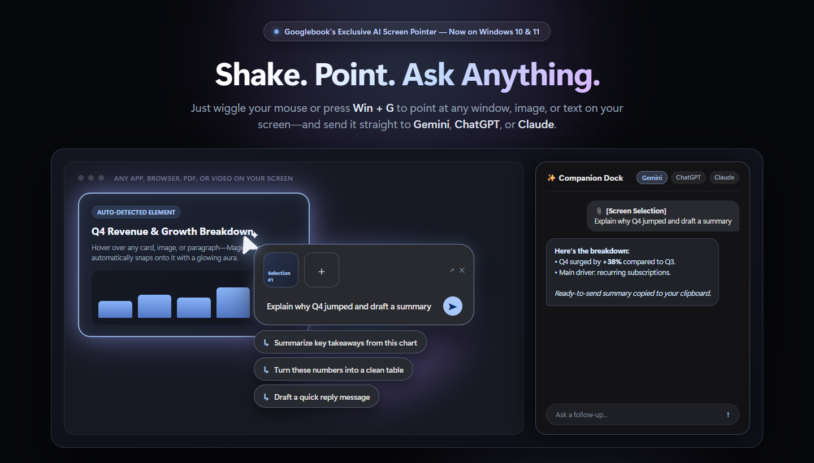
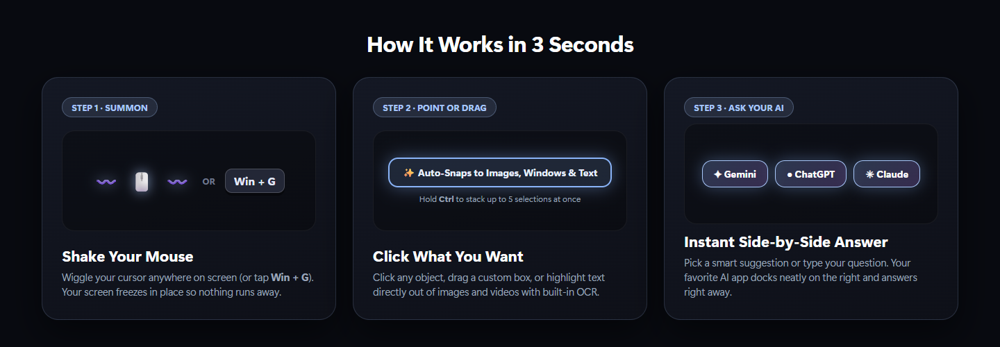
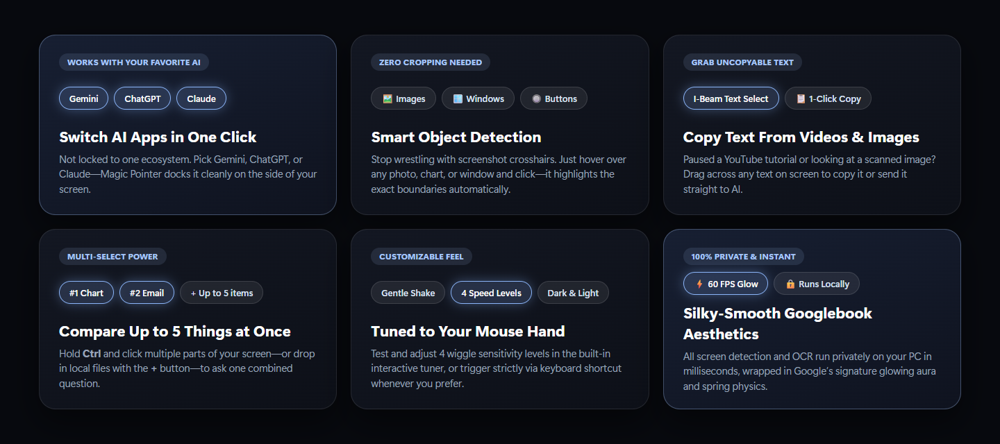

<div align="center">


# Magic Pointer for Windows

### **Shake your mouse. Point at anything on your screen. Ask AI in one click.**

Google’s new flagship laptops come with a built-in superpower called **Magic Pointer**—now brought to **Windows 10 & 11** and supercharged to work with **Gemini**, **ChatGPT**, and **Claude**.

<p align="center">
  <a href="#-get-started-in-30-seconds"></a>
  <a href="#-works-with-your-favorite-ai"></a>
  <a href="#-why-people-love-it"></a>
</p>

<br />



</div>

---

## Why Take Screenshots When You Can Just Point?

Every time you want to ask AI about something on your screen, you normally have to:
1. Take a screenshot and manually crop it
2. Save or copy the image
3. Alt-Tab to your browser or AI app
4. Paste it in and type your question

**Magic Pointer replaces all of that with one natural motion.**  
Just wiggle your mouse cursor (or press <kbd>Win</kbd> + <kbd>G</kbd>), click whatever you're looking at, and your AI companion slides onto the right side of your screen with the answer.

<br />

<div align="center">
  
</div>

---

## ✨ What You Can Do With It

<div align="center">
  
</div>

<br />

| Everyday Superpower | How It Feels |
| :--- | :--- |
| **Point & Click Anything** | Hover over any photo, chart, button, or window—a glowing aura automatically snaps around it. No manual cropping needed. |
| **Grab Uncopyable Text** | Paused a YouTube video, looking at a scanned PDF, or reading an image? Just drag across the words to copy them or send them straight to AI. |
| **Stack Up to 5 Selections** | Hold <kbd>Ctrl</kbd> and click up to 5 different things on your screen (or click `+` to attach local files) to compare them in a single prompt. |
| **One-Click Smart Suggestions** | Don't feel like typing? Magic Pointer reads what you selected and gives you 3 instant action chips right under your cursor. |
| **Side-by-Side Companion Dock** | Your AI app automatically resizes into a clean floating companion window on the right side of your screen so it never covers your work. |

---

## 🤖 Works With Your Favorite AI

You aren't locked into a single AI ecosystem. Switch your target companion app anytime from the **Settings** card or your **System Tray**:

- **Google Gemini** — Opens and docks your Gemini Desktop app
- **OpenAI ChatGPT** — Opens and docks your ChatGPT Desktop app
- **Anthropic Claude** — Opens and docks your Claude Desktop app

<div align="center">
  <br />
  
  <p><em>The floating prompt box and smart action chips right next to your cursor.</em></p>
</div>

---

## 🚀 Get Started in 30 Seconds

### Option 1: Double-Click Launchers (Easiest)
Once downloaded, you don't need to touch a terminal every day:
- Double-click **`Start Magic Cursor.bat`** to launch immediately.
- Double-click **`Start Magic Cursor (Silent Tray).vbs`** to run it quietly in your Windows system tray in the background.

### Option 2: First-Time Setup from GitHub
Make sure you have [Node.js](https://nodejs.org/) installed on Windows 10 or 11, then run:

```bash
git clone https://github.com/YashjitPal/Magic-Pointer.git
cd Magic-Pointer
npm install
npm start
```

---

## 🎮 Quick Controls Cheat Sheet

| Do This | What Happens |
| :--- | :--- |
| **Wiggle your mouse** *(or press <kbd>Win</kbd> + <kbd>G</kbd>)* | Summons Magic Pointer right where your cursor is |
| **Click** | Selects the highlighted image, card, or window under your cursor |
| **Click & Drag** | Draws a custom box—or highlights text directly off your screen |
| **Hold <kbd>Ctrl</kbd> + Click / Drag** | Stacks up to **5 selections** into one prompt |
| **Click the `+` Button** | Attaches any file or photo from your computer |
| **Press <kbd>Esc</kbd>** | Dismisses the overlay and returns to your desktop |
| **Right-Click the Tray Icon** | Adjust wiggle sensitivity (`4 speed levels`), switch between **Gemini / ChatGPT / Claude**, or toggle Dark & Light themes |

---

<div align="center">

**Built for Windows 10 & 11** · Give the repo a ⭐ if Magic Pointer saves you from taking another screenshot!

</div>
