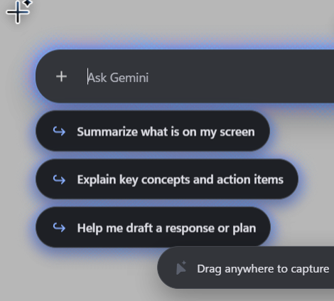

<div align="center">


# Magic Pointer

**Googlebook's `com.google.android.desktop.gpointer.app`, ported to Windows.**

Wiggle your cursor or press <kbd>Win</kbd> + <kbd>G</kbd> to point at anything on your screen and send it to Gemini in Chrome.

<br />



</div>

---

## Overview

Google's new desktop laptops ship with a built-in system app called **Magic Pointer** (`com.google.android.desktop.gpointer.app`). When you shake your mouse cursor, it freezes a snapshot of the screen in RAM, runs local MediaPipe TFLite models to detect UI elements, objects, and text under your cursor, and opens a floating prompt box attached to your pointer.

This repo is a reverse-engineered Windows port built directly from the unpacked APK (`1.0.260916`). It runs the original shaders, TFLite models, Lottie assets, and spring constants from the decompiled source.

## What's Inside

- **Original AGSL Energy Shader (`extracted_assets/shaders/energy_shader.glsl`)** — Ported to WebGL2 (`renderer.js`). Renders the simplex-noise glow and halftone dot pattern around the selection box, prompt box, suggestion chips, and loading skeletons using the exact uniform presets (`DefaultCardConfig`, `DefaultChipConfig`, `DefaultLoaderConfig`).
- **Original On-Device Vision Models (`extracted_assets/models/`)** — Runs `mobile_raid_v2_2_float32_finetuned_0804.tflite` (windows & UI controls) and `mobile_raid_common_object_33_int8_0730_w_metadata.tflite` (objects) locally in a Web Worker via MediaPipe WASM, alongside an 8x8 grayscale histogram cache (`CommonObjectCache`).
- **Low-Latency Win32 Hook & OCR (`native/MagicCursorNative.cs`)** — A lightweight C# background process that watches `WH_MOUSE_LL` for cursor wiggles, grabs a `BitBlt` screen capture before the overlay shows, enumerates DWM window rects, and runs `Windows.Media.Ocr` for text selection.
- **Compose Spring Physics** — Uses the same spring parameters as `MainScreenKt.java` and `PromptBoxKt.java`:
  - Prompt box cursor follow & screen-edge clamping: `stiffness = 1500`, `damping = 1.0`
  - AOI bounding box morphing: `stiffness = 700` (position) / `1400` (size)
  - Suggestion chip stagger: `250ms` cubic-bezier with `50ms` per-chip delay
  - Multi-select thumbnail grid (`SelectedAOIsDisplay`): 2-column reflow (`stiffness = 400`) up to 5 items
- **First-Time Experience (FTE) & Wiggle Tuner** — The 3-step onboarding dialog and 4-speed wiggle sensitivity tester (`Speed 0–3`) using the original Lottie animations (`swatchie__fte_wiggle_banner_*`).

---

## Usage

### Requirements
- Windows 10 or 11 (x64)
- [Node.js](https://nodejs.org/) 18+
- Google Chrome

### Run

```bash
git clone https://github.com/YashjitPal/Magic-Pointer.git
cd Magic-Pointer
npm install
npm start
```

Or double-click:
- `Start Magic Cursor.bat` — starts immediately
- `Start Magic Cursor (Silent Tray).vbs` — runs headless in the system tray

---

## Controls

| Input | Action |
| :--- | :--- |
| **Wiggle cursor** / <kbd>Win</kbd> + <kbd>G</kbd> / <kbd>Alt</kbd> + <kbd>M</kbd> | Open Magic Pointer at cursor |
| **Click** | Select hovered object or UI element |
| **Click & drag** | Draw custom region or highlight screen text (I-Beam) |
| **Hold <kbd>Ctrl</kbd> + Click / Drag** | Multi-select up to 5 regions |
| **`+` button** | Attach local files or images |
| <kbd>Esc</kbd> | Close overlay |
| **System Tray icon** (right-click) | Change wiggle sensitivity (`Speed 0–3`), toggle dark/light theme, or open FTE tutorial |

---

## Project Layout

```text
├── main.js                        # Electron main process, overlay window, tray & IPC
├── preload.js                     # IPC bridge
├── renderer.js                    # WebGL2 shader pipeline, spring physics, UI & AOI logic
├── vision_worker.js               # MediaPipe TFLite worker (MobileRaid v2.2 + Common Object)
├── index.html                     # Overlay markup
├── styles.css                     # Material 3 styles & tokens
├── native/
│   ├── MagicCursorNative.cs       # Win32 mouse hook, BitBlt capture, DWM windows & WinRT OCR
│   └── MagicCursorNative_v3.exe   # Compiled native helper
└── extracted_assets/
    ├── shaders/energy_shader.glsl # Decompiled AGSL/GLSL shader
    ├── models/                    # Extracted .tflite segmentation & OCR models
    ├── mediapipe/                 # MediaPipe Tasks Vision WASM runtime
    ├── lottie/                    # Extracted FTE & wiggle banner animations
    └── svg/                       # Extracted cursors & icons
```
